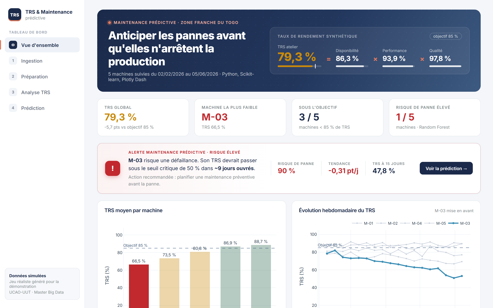
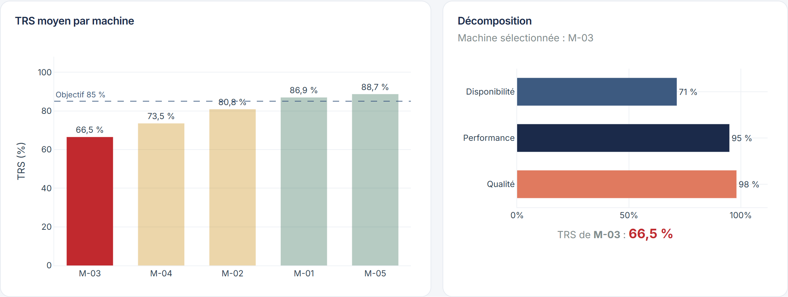
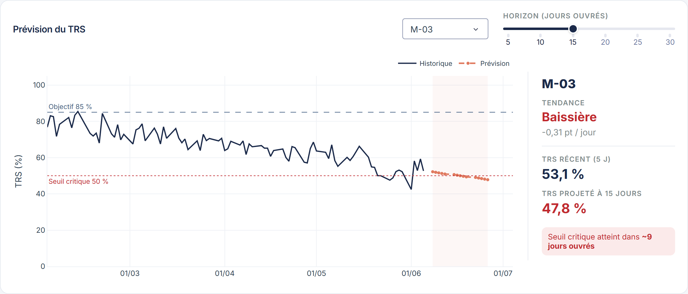

# Tableau de bord TRS & Maintenance prédictive — Zone Franche Togo

Projet Big Data complet, de la donnée brute jusqu'à la **prédiction** :
calcul et suivi du **Taux de Rendement Synthétique (TRS)** et **maintenance
prédictive** (prévision du TRS et risque de panne par machine).

```
TRS = Disponibilité × Performance × Qualité
```



📄 **[Rapport technique (PDF)](docs/rapport/rapport.pdf)** : données, construction des
variables, entraînement et évaluation des modèles, limites.

> **À propos des données** — les données de production industrielles sont
> confidentielles. Le projet est livré avec un **jeu de données simulé de façon
> réaliste** (5 machines, ~4 mois), généré par `generer_donnees.py`, avec un
> scénario contrôlé : une machine se dégrade progressivement. Cela permet de
> vérifier que la chaîne détecte bien une anomalie connue. L'application accepte
> de vraies données de production (voir [Utiliser de vraies données](#utiliser-de-vraies-données)).

## Aperçu

Tableau de bord interactif **Plotly Dash** en 5 pages :

| Page | Contenu |
|---|---|
| **Vue d'ensemble** | TRS de l'atelier décomposé (D × P × Q), indicateurs clés, alerte de maintenance prédictive, graphiques principaux. |
| **Ingestion** | Import du CSV d'une usine (virgule ou point-virgule), validation automatique du schéma, modèle CSV téléchargeable. |
| **Préparation** | Nettoyage et rapport de qualité : lignes rejetées, valeurs manquantes, contrôles de cohérence. |
| **Analyse TRS** | Filtres machines / période, KPI, classement, décomposition, diagnostic automatique, évolution hebdomadaire. Graphiques liés : cliquer sur une machine la met en avant partout. |
| **Prédiction** | Risque de panne par machine (Random Forest), prévision du TRS (régression), métriques, importance des variables, matrice de confusion. |

Chaque graphique s'exporte en PNG haute définition (icône appareil photo).

| Analyse TRS | Prédiction |
|---|---|
|  |  |

## Prérequis

- **Python 3.10+**
- **pip**

## Installation

```bash
# 1. Cloner le dépôt
git clone https://github.com/kkepiphane/trs-zone-franche-tg.git
cd trs-zone-franche-tg

# 2. Créer et activer un environnement virtuel
python -m venv venv
source venv/bin/activate        # Linux / macOS
# venv\Scripts\activate         # Windows

# 3. Installer les dépendances
pip install -r requirements.txt
```

## Lancement

```bash
python app.py
```

Puis ouvrir **http://127.0.0.1:8050** dans le navigateur.

> Au premier lancement, `production.csv` (données de démonstration) est généré
> automatiquement s'il est absent. Si le notebook n'a pas encore produit
> `modele_risque.joblib`, le modèle de risque est entraîné au démarrage.

### Déploiement

L'application expose un point d'entrée WSGI (`server`) pour un hébergement
(Render, Railway, VPS…) :

```bash
gunicorn app:server
```

## Structure du projet

```
trs-zone-franche-tg/
├── app.py                              # Tableau de bord interactif (Plotly Dash)
├── assets/
│   └── style.css                       # Thème du tableau de bord (chargé par Dash)
├── calcul_trs.py                       # Nettoyage et calcul du TRS
├── prediction.py                       # Modèles ML (prévision TRS + risque de panne)
├── generer_donnees.py                  # Génération de données simulées réalistes
├── maintenance_predictive_TRS.ipynb    # Notebook d'analyse Data Science
├── docs/
│   ├── images/                         # Captures du tableau de bord (README)
│   └── rapport/
│       ├── rapport.pdf                 # Rapport technique
│       ├── rapport.tex                 # Source LaTeX (xelatex, 2 passes)
│       ├── generer_figures.py          # Régénère les figures du rapport
│       └── figures/
├── requirements.txt                    # Dépendances Python
└── README.md
```

La logique métier (`calcul_trs.py`, `prediction.py`) est indépendante de
l'interface : elle est utilisée telle quelle par le notebook et par le tableau de bord.

Fichiers générés (non versionnés) :

| Fichier | Rôle |
|---|---|
| `production.csv` | Données de démonstration (~4 mois, 5 machines). Régénéré par `generer_donnees.py`. |
| `modele_risque.joblib` | Modèle Random Forest exporté par le notebook. |

## Scénario de démonstration

- Atelier de 5 machines sur ~4 mois, TRS global ~79 % (objectif 85 %).
- **M-03** se dégrade dans le temps : sa disponibilité chute et son TRS baisse.
- La **Vue d'ensemble** déclenche une alerte sur M-03 : risque de panne élevé et
  seuil critique de TRS (50 %) atteint dans quelques jours ouvrés selon la tendance.
- Page **Prédiction** :
  - le **modèle de risque** classe M-03 en risque ÉLEVÉ, les autres machines en FAIBLE ;
  - la **prévision** montre la tendance baissière du TRS de M-03.
- Message clé : on anticipe la défaillance et on planifie la maintenance **avant** la panne.

## Utiliser de vraies données

Importer depuis la page **Ingestion** un fichier CSV comportant au minimum les colonnes :

```
machine, date, temps_prevu, temps_marche, prod_theorique, prod_reelle, pieces_bonnes
```

Colonnes supplémentaires nécessaires au **modèle de risque de panne** :

```
nb_arrets, micro_arrets, temp_moteur
```

Sans elles, l'analyse TRS et la prévision restent disponibles ; seul le modèle de
risque est désactivé (un message l'indique). Pour des données importées, le modèle
est réentraîné sur ces données.

## Notebook d'analyse (démarche Data Science)

**`maintenance_predictive_TRS.ipynb`** détaille toute la démarche, étape par étape :
exploration (EDA), corrélations, construction des features, entraînement des deux
modèles (prévision du TRS + risque de panne), évaluation et **export du modèle**
(`modele_risque.joblib`).

### Ordre d'utilisation recommandé

1. Générer les données : `python generer_donnees.py`
2. Exécuter le notebook : `jupyter notebook maintenance_predictive_TRS.ipynb`
   — il produit `modele_risque.joblib`.
3. Lancer le tableau de bord : `python app.py`
   — il **charge** le modèle exporté par le notebook (et l'entraîne à la volée
   s'il ne le trouve pas).

Cette séparation reproduit la pratique professionnelle : on **expérimente et
entraîne** dans le notebook, on **déploie** le modèle figé dans l'application.

## Démarche d'ingénieur

- Pipeline complet visible : ingestion → préparation → analyse → prédiction.
- Construction de **features** sur fenêtre glissante (tendance du TRS, arrêts,
  micro-arrêts, température moteur…).
- Séparation **train/test**, **métriques** (exactitude, précision, rappel, F1),
  **matrice de confusion**, **importance des variables**.
- Honnêteté scientifique : les pannes sont rares (classes déséquilibrées), ce qui
  limite le rappel ; le tableau de bord l'explique et propose des pistes
  (plus d'historique, rééquilibrage SMOTE, ajustement du seuil de décision).

## Technologies

Python · Pandas · NumPy · Scikit-learn · Plotly Dash · Joblib · Jupyter

## Licence

Distribué sous licence [MIT](LICENSE) © 2026 KOUTSAVA Kossi Epiphane.
